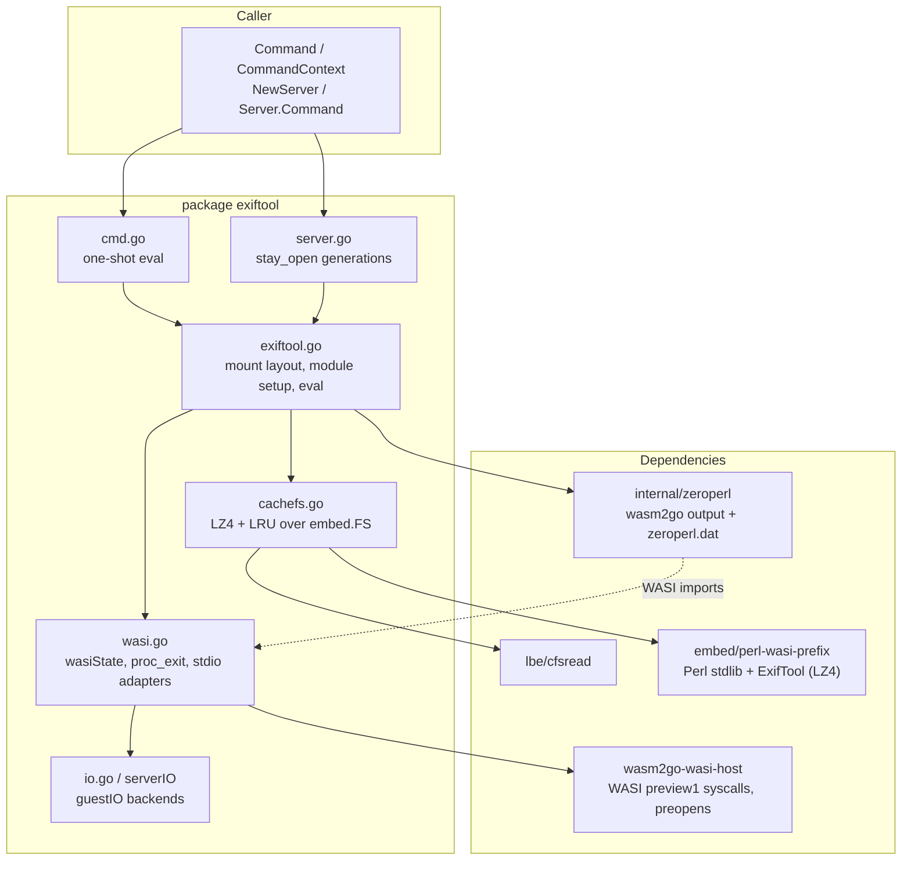
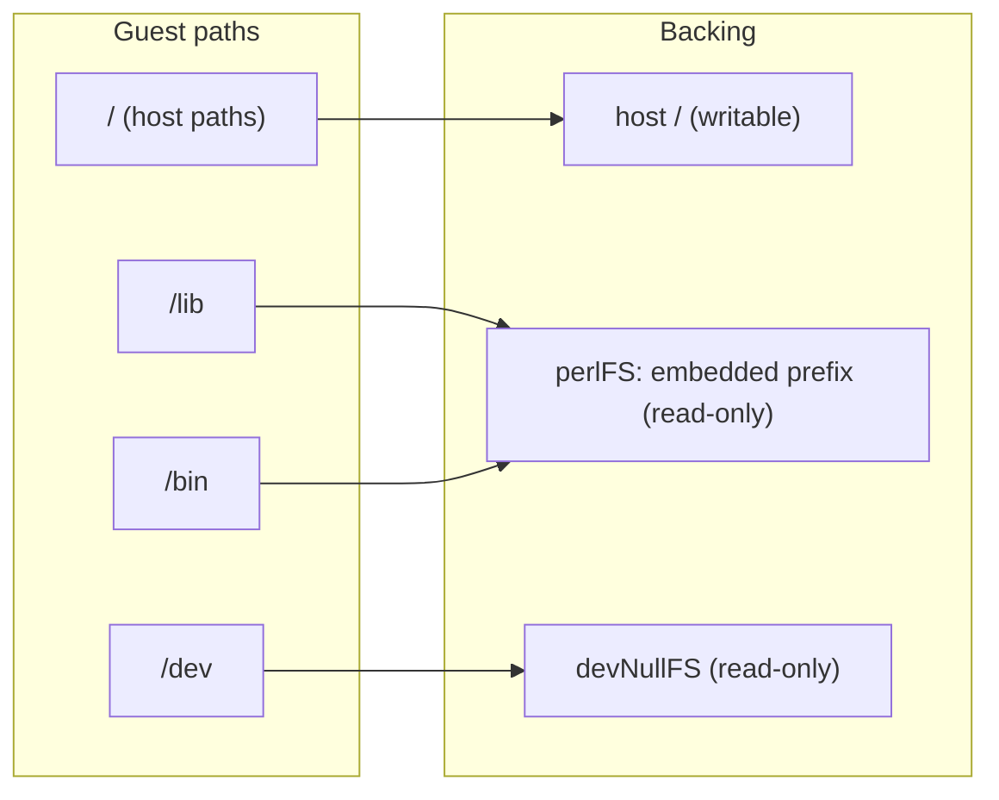
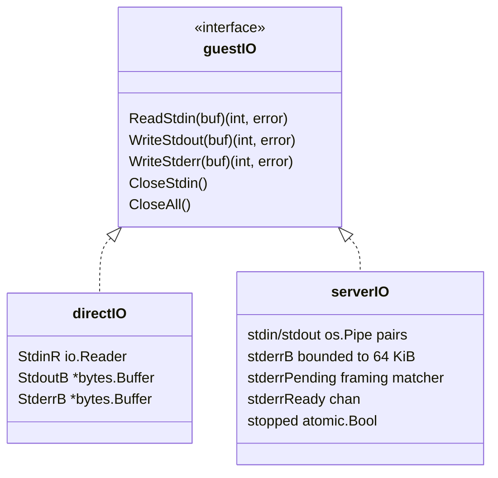
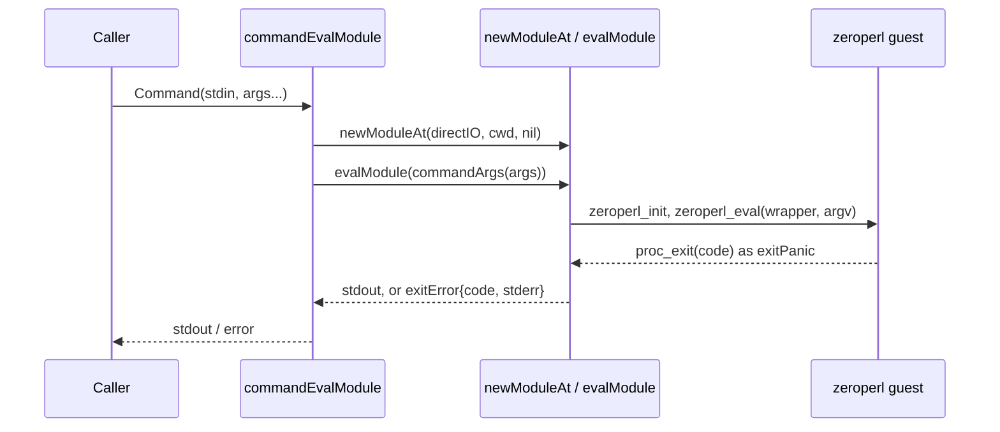
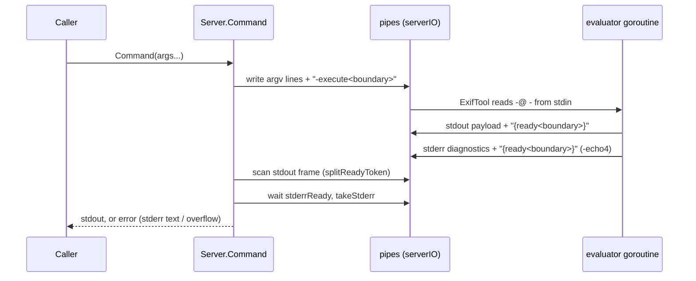
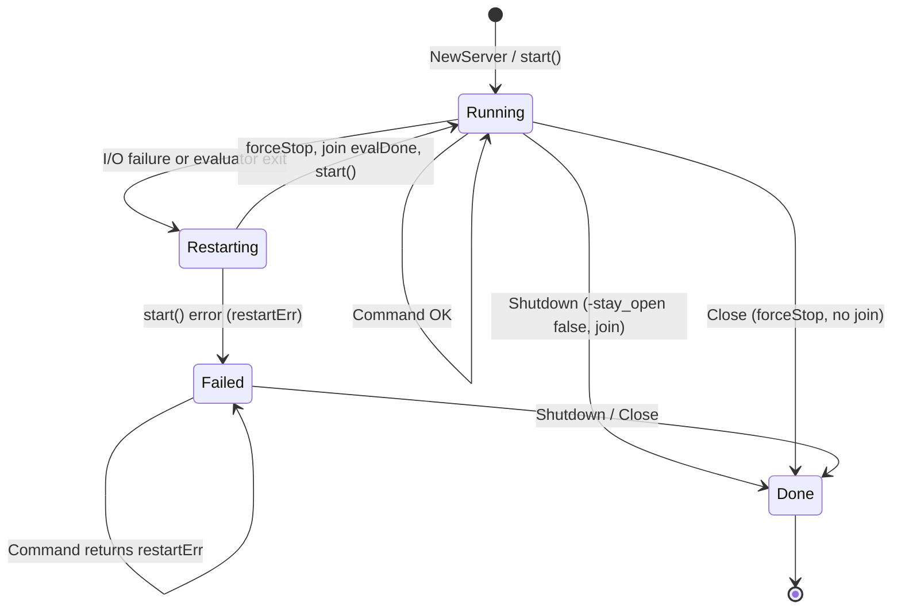

# Architecture: go-exiftool-wasm

Package `exiftool` runs [ExifTool](https://exiftool.org/) in-process.
[zeroperl](https://github.com/uswriting/zeroperl) compiles Perl and ExifTool to WebAssembly, wasm2go
translates the module to native Go, and
[wasm2go-wasi-host](https://github.com/lbe/wasm2go-wasi-host) implements its WASI system calls. At
run time there is no WASM interpreter, no host Perl and no `exiftool` binary.

## Goals and constraints

- No `os/exec` and no host `exiftool`. Everything ships inside the Go module.
- The public API matches `ncruces/go-exiftool`: `Command`, `CommandContext`, `NewServer`,
  `Server.Command`, `Server.Close`, `Server.Shutdown`, `Unmarshal`, and the package variables
  `Exec`, `Arg1` and `Config`. The package keeps `Exec` but ignores it.
- For the same arguments, stdout, `SourceFile` spellings and exit status should match native
  ExifTool. [Known limitations](#known-limitations) lists the exceptions.

## Layers



## Source files

| File                | Responsibility                                                                                                                                  |
| ------------------- | ----------------------------------------------------------------------------------------------------------------------------------------------- |
| `init.go`           | Package documentation; `Exec`, `Arg1`, `Config`                                                                                                 |
| `cmd.go`            | `Command`, `CommandContext`, `exitError`; one-shot eval and `-json` per-file error detection                                                    |
| `server.go`         | `Server`, interpreter generations, `serverIO` (pipes, bounded stderr, framing), stay_open protocol, restart after I/O failure                   |
| `exiftool.go`       | `go:embed` of the Perl prefix, `perlFS`, argv prefix (`Arg1`/`Config`/charset), mount layout (`buildModuleConfig`), `newModuleAt`, `evalModule` |
| `wasi.go`           | `wasiState` (embeds `wasihost.State`, holds the guest cwd), `exitPanic`, `cancelPanic`, stdin/stdout/stderr adapters                            |
| `io.go`             | `guestIO` interface and the in-memory `directIO` backend                                                                                        |
| `cachefs.go`        | `cachedFS`: `fs.FS` wrapper that decompresses LZ4 and caches in an LRU (via `cfsread`)                                                          |
| `decode.go`         | `Unmarshal` for line-oriented `Key: value` output                                                                                               |
| `internal/zeroperl` | Generated wasm2go module (`zeroperl.go`, `zeroperl.dat`); never edited by hand                                                                  |
| `internal/testutil` | Test helpers (`Root`, `SampleJPEG`)                                                                                                             |

## Guest module

`newModuleAt` creates one guest instance in three steps:

1. `wasm2go.New(ws, ws)`. One `*wasiState` implements both the `env` and the
   `wasi_snapshot_preview1` imports.
2. `initWASIState` attaches the stdio adapters for the chosen `guestIO` and calls
   `wasihost.New(memFn, cfg)`. `memFn` reads `mod.Xmemory()` again on every system call, so guest
   memory can grow.
3. `mod.X_initialize()`.

To run ExifTool, the package calls `Xzeroperl_init` and then `Xzeroperl_eval` with
`exiftoolEvalWrapper`. That short Perl preamble turns on autoflush, changes to the host cwd, adds
`/lib/perl5` and `/lib/perl5/wasm32-wasi` to `@INC`, sets `$0`, and runs `/bin/exiftool` with `do`.
The package copies strings and the argv array into guest memory with `Xmalloc` and frees them with
`Xfree`.

**Exit model.** `wasiState.Xproc_exit` panics with `exitPanic{code}`. Each place that runs the guest
recovers that panic: `evalModule`, `initModule` and the Server evaluator goroutine. Any other panic
propagates. A `wasihost.State` is not safe for concurrent use, so one goroutine drives each module.

## Filesystem and mounts



`buildModuleConfig` in `exiftool.go` sets up these mounts:

| Guest path     | Kind                         | Backing                                                                                |
| -------------- | ---------------------------- | -------------------------------------------------------------------------------------- |
| `/`            | writable host dir preopen    | host `/`; a guest path is the same as the host path                                    |
| `/lib`, `/bin` | read-only `fs.FS`            | `perlFS()` subtrees; `/bin/exiftool` is the driver script; hide host `/lib` and `/bin` |
| `/dev`         | read-only `fs.FS`            | `devNullFS` (`/dev/null`)                                                              |
| `/work`        | read-only `fs.FS` (optional) | `workFS` parameter; every current caller passes `nil`                                  |

wasm2go-wasi-host resolves each guest path through the longest matching preopen, so the embedded
mounts take precedence over the root preopen for their prefixes. A writable host preopen confines
symlinks to its host root with `EvalSymlinks`. When the host root is `/`, every resolved path is
inside it, so the check never fails. Operands need no extra preopens.

### Known limitations

- The guest resolves `..` after a symlink lexically, but native ExifTool follows the symlink first.
  Pass clean paths.
- The embedded mounts hide host files under `/lib`, `/bin` and `/dev`.
- Windows is not supported until wasm2go-wasi-host builds there.
- A failed command returns a plain error, not an `*exec.ExitError`, so there is no `ExitCode()` or
  `Stderr` field. The error text includes stderr.
- `Exec` is kept for compatibility but ignored. ExifTool always runs in-process.

**Embedded tree.** `perlFS()` is one `cachedFS` per process over `embed/perl-wasi-prefix`, with a
2000-entry LRU. The binary stores the files LZ4-compressed, and `cachedFS` decompresses each one on
first read. README.md describes the `cfsread-lz4` step.

## I/O



- `directIO` serves one-shot commands. It reads stdin from the caller's reader and keeps stdout and
  stderr in memory.
- `serverIO` serves stay_open. Stdin and stdout are `os.Pipe` pairs. A fixed-size prefix buffer
  matches stderr bytes against the ready token, so it finds a token split across writes, even after
  the payload has passed its 64 KiB cap. A complete token signals `stderrReady`.
- The stdio adapters in `wasi.go` turn EOF, a closed pipe or a stopped `serverIO` into
  `exitPanic{0}`. A stay_open evaluator therefore exits at its next host I/O call instead of looping
  in ExifTool's poll loop. One-shot stdin behaves like any `io.Reader`.

## One-shot flow



`cmd.go` turns the guest's result into a return value by these rules:

- Exit 0 returns stdout and a nil error, even if ExifTool wrote warnings to stderr. If `-json`
  output has a per-file `Error` field, it returns `exitError{Code: 1}`, as native ExifTool's exit
  status would.
- A non-zero exit returns the captured stdout and `exitError{Code, Msg}`, where `Msg` includes
  stderr.

`CommandContext` returns `ctx.Err()` without starting the guest if `ctx` is already done. During a
run, `wasiState` checks `ctx` in `nanosleep`, `fd_read` and `fd_write`. Once `ctx` is done, the next
such call panics with `cancelPanic`, and `CommandContext` returns the stdout written so far and
`ctx.Err()`. Guest code that makes none of those calls runs until it makes one. A `Server` uses
`context.Background()`. Each call pays the full interpreter start-up cost, about 0.4 s. `Server`
exists to pay it once.

## Server (stay_open)

`NewServer` builds this argv:

```text
[Arg1] [-config Config] -stay_open true -@ - -common_args -echo4 {ready<boundary>} -charset filename=utf8 <commonArg...>
```

It then starts a generation. A generation is a module, its `wasiState`, a `serverIO`, a stdout
scanner, and an evaluator goroutine that runs `zeroperl_eval`. The goroutine recovers `exitPanic`,
closes its pipe ends, drops its module references and closes `evalDone`. It never touches `Server`.





Concurrency and lifecycle rules:

- `cmdMtx` serializes `Command` and `Shutdown`. `srvMtx` guards `done`, `generation` and restart.
- A restart force-stops the old generation and waits for its `evalDone` before it starts the
  replacement, so two evaluators never run at once.
- `Shutdown` sends `-stay_open false`, closes stdin and waits for the evaluator. `Close` marks the
  server done and closes the pipes without waiting. The evaluator exits at its next host I/O call.
- Callers must not call `Close` or `Shutdown` while a `Command` is running. A second `Close`
  succeeds. A second `Shutdown` fails, and so does any command after either one.

## Tests and tooling

See [TESTING.md](TESTING.md). The file suffix and build tag mark each test kind: `*_test.go` for
unit tests, `*_integration_test.go` with `integration`, and `*_e2e_test.go` with `e2e`. CI runs all
of them under `-race`, and golangci-lint runs with both tags and again with `ncruces`. README.md
describes how to rebuild the embedded tree with `dist.pl` and `cfsread-lz4`. The immutable
conformance suite, `conformance_*_test.go`, runs the same public-API tests against this package
(`integration` tag) and against ncruces/go-exiftool (`ncruces` tag).
