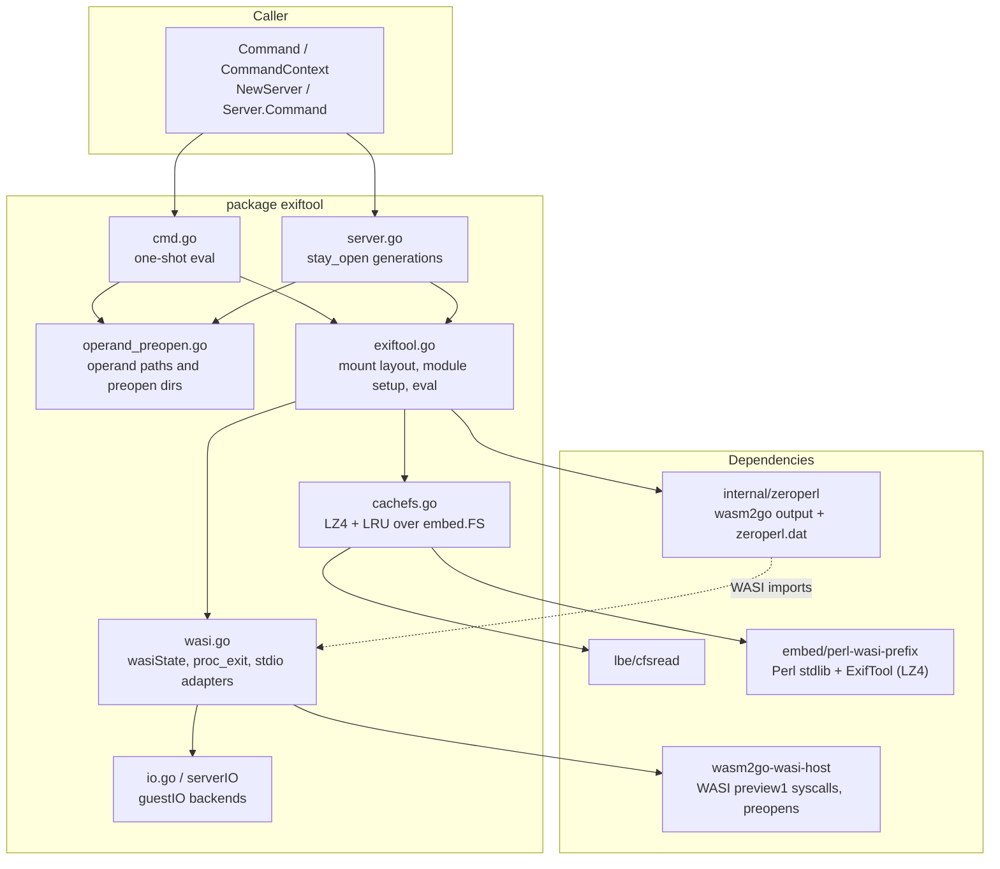
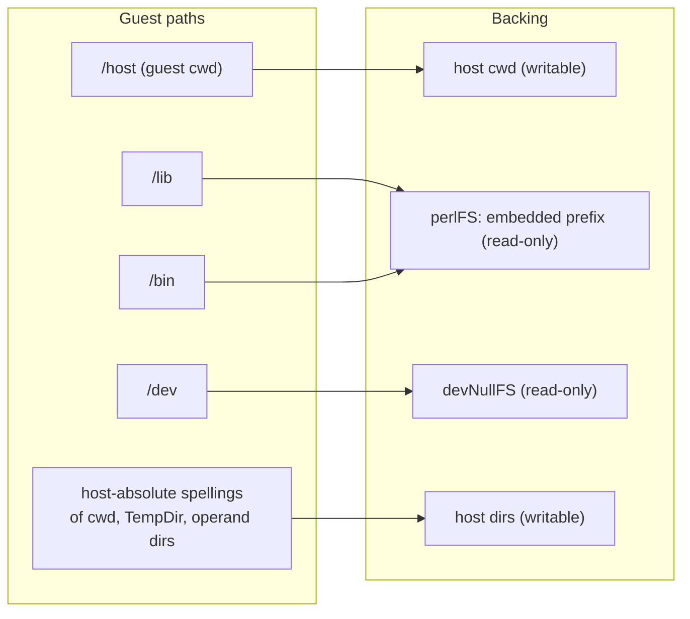
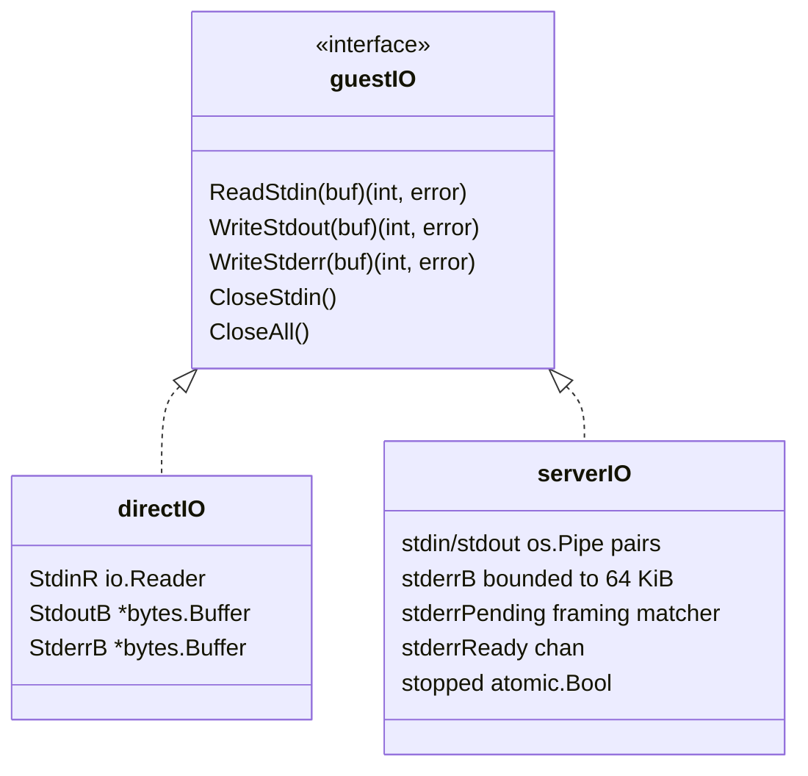
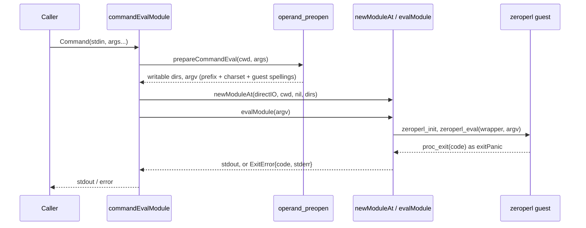
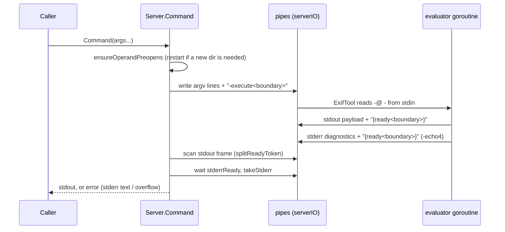
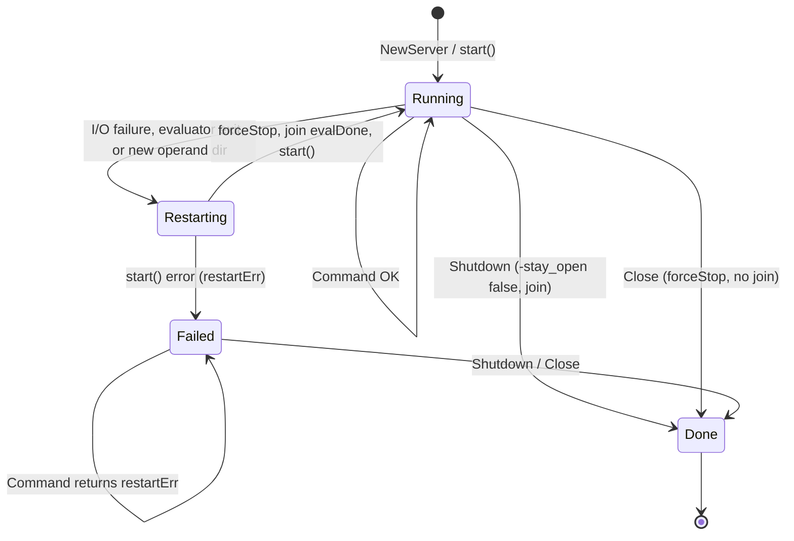

# Architecture: go-exiftool-wasm

Package `exiftool` runs [ExifTool](https://exiftool.org/) in-process. Perl and ExifTool are compiled
to WebAssembly by [zeroperl](https://github.com/uswriting/zeroperl), translated to native Go by
wasm2go, and given a WASI environment by
[wasm2go-wasi-host](https://github.com/lbe/wasm2go-wasi-host). No WASM interpreter, host Perl, or
`exiftool` binary is involved at run time.

## Goals and constraints

- No `os/exec` and no host `exiftool`; everything ships inside the Go module.
- Public API compatible with `ncruces/go-exiftool`: `Command`, `CommandContext`, `NewServer`,
  `Server.Command`, `Server.Close`, `Server.Shutdown`, `Unmarshal`, `ExitError`, and the package
  variables `Exec`, `Arg1`, `Config`. `Exec` is retained but ignored.
- Output (stdout, `SourceFile` spellings, exit status) should match native ExifTool for the same
  arguments.

## Layers

## Source files

| File                 | Responsibility                                                                                                                                  |
| -------------------- | ----------------------------------------------------------------------------------------------------------------------------------------------- |
| `init.go`            | Package documentation; `Exec`, `Arg1`, `Config`                                                                                                 |
| `cmd.go`             | `Command`, `CommandContext`, `ExitError`; one-shot eval and `-json` per-file error detection                                                    |
| `server.go`          | `Server`, interpreter generations, `serverIO` (pipes, bounded stderr, framing), stay_open protocol, restart                                     |
| `exiftool.go`        | `go:embed` of the Perl prefix, `perlFS`, argv prefix (`Arg1`/`Config`/charset), mount layout (`buildModuleConfig`), `newModuleAt`, `evalModule` |
| `operand_preopen.go` | Finds file operands in argv, derives extra writable preopen dirs, chooses the operand spelling passed to the guest                              |
| `wasi.go`            | `wasiState` (embeds `wasihost.State`), `exitPanic`, stdin/stdout/stderr adapters                                                                |
| `io.go`              | `guestIO` interface and the in-memory `directIO` backend                                                                                        |
| `cachefs.go`         | `cachedFS`: `fs.FS` wrapper with transparent LZ4 decompression and LRU cache (via `cfsread`)                                                    |
| `decode.go`          | `Unmarshal` for line-oriented `Key: value` output                                                                                               |
| `printer.go`         | Buffered line writer; currently referenced only by tests                                                                                        |
| `internal/zeroperl`  | Generated wasm2go module (`zeroperl.go`, `zeroperl.dat`); never hand-edited                                                                     |
| `internal/testutil`  | Test helpers (`Root`, `SampleJPEG`)                                                                                                             |

## Guest module

`newModuleAt` creates one guest instance:

1. `wasm2go.New(ws, ws)`: the same `*wasiState` serves both the `env` and `wasi_snapshot_preview1`
   import interfaces.
2. `initWASIState` attaches stdio adapters for the chosen `guestIO` and constructs
   `wasihost.New(memFn, cfg)`. `memFn` re-reads `mod.Xmemory()` on every syscall so memory growth is
   safe.
3. `mod.X_initialize()`.

Evaluation then calls `Xzeroperl_init` and `Xzeroperl_eval` with `exiftoolEvalWrapper`, a short Perl
preamble that enables autoflush, `chdir`s to `/host`, prepends `/lib/perl5` and
`/lib/perl5/wasm32-wasi` to `@INC`, sets `$0`, and `do`es `/bin/exiftool`. Strings and the argv
array are copied into guest memory with `Xmalloc` and released with `Xfree`.

**Exit model.** `wasiState.Xproc_exit` panics with `exitPanic{code}`. Every eval boundary
(`evalModule`, `initModule`, the Server evaluator goroutine) recovers it; any other panic is
re-raised. A `wasihost.State` is not safe for concurrent use, so each module is driven by one
goroutine.

## Filesystem and mounts

`buildModuleConfig` (`exiftool.go`) builds the layout:

| Guest path                           | Kind                         | Backing                                                              |
| ------------------------------------ | ---------------------------- | -------------------------------------------------------------------- |
| `/host`                              | writable host dir preopen    | caller cwd; guest cwd after the preamble `chdir`                     |
| `/lib`, `/bin`                       | read-only `fs.FS`            | `perlFS()` subtrees; `/bin/exiftool` is the driver script            |
| `/dev`                               | read-only `fs.FS`            | `devNullFS` (`/dev/null`)                                            |
| cwd's host spelling(s)               | writable host dir preopen    | cwd, also at its `EvalSymlinks` spelling (e.g. macOS `/private/var`) |
| `os.TempDir()` spelling(s)           | writable host dir preopen    | temp dir                                                             |
| operand parent dirs outside cwd/temp | writable host dir preopen    | from `operandPreopenDirs`, each with its canonical alias             |
| `/work`                              | read-only `fs.FS` (optional) | `workFS` parameter; every current caller passes `nil`                |

wasm2go-wasi-host resolves a guest path through the **longest matching preopen**. Writable host
preopens enforce `EvalSymlinks` confinement, so a symlink that escapes its preopen fails with
`ENOTCAPABLE`. That is why every directory an operand lives in must be preopened.

**Operand handling** (`operand_preopen.go`). `scanFileOperands` walks argv, skipping flags, values
of flags that take a non-path argument (`-ext`, `-charset`, …), and honoring `--`. Path-valued flags
such as `-config` and `-o` count as operands. For each operand:

- `operandPreopenDirs` adds its parent directory (lexical and canonical spellings) when it lies
  outside cwd and `os.TempDir()`.
- `guestPathForOperand` chooses the spelling ExifTool sees: the original relative spelling for a
  path under cwd; the host-absolute path for anything outside cwd or under temp only; an absolute
  path under cwd becomes relative to cwd.

**Embedded tree.** `perlFS()` is a process-wide `cachedFS` over `embed/perl-wasi-prefix`, built once
with a 2000-entry LRU. Files are stored LZ4-compressed in the binary (see README for the
`cfsread-lz4` step) and decompressed on first read.

## I/O

- `directIO` (one-shot): stdin from the caller's reader, stdout/stderr captured in memory.
- `serverIO` (stay_open): stdin and stdout are `os.Pipe`s. Stderr bytes are matched against the
  ready token with a fixed-size prefix buffer, so frames split across writes are recognized even
  after the payload overflows its 64 KiB cap. A complete token signals `stderrReady`.
- The stdio adapters in `wasi.go` turn EOF, closed pipes, or a stopped `serverIO` into
  `exitPanic{0}`. A stay_open evaluator therefore leaves at its next host I/O call instead of
  spinning in ExifTool's poll loop. One-shot stdin keeps ordinary `io.Reader` semantics.

## One-shot flow

Result rules (`cmd.go`):

- Exit 0 with empty stderr: stdout, or `ExitError{Code: 1}` if `-json` output contains a per-file
  `Error` field (matching native exit status).
- Exit 0 with stderr text: stdout plus an error carrying the stderr text.
- Non-zero exit: captured stdout plus `ExitError{Code, Msg}` including stderr.

`CommandContext` checks `ctx` only before starting. Once the guest runs it completes or exits;
native guest computation cannot be preempted. Each call pays the full interpreter start-up cost
(several seconds), which is the reason `Server` exists.

## Server (stay_open)

`NewServer` builds argv
`[Arg1] [-config Config] -stay_open true -@ - -common_args -echo4 {ready<boundary>} -charset filename=utf8 <commonArg...>`.
It then starts a **generation**: a module, its `wasiState`, a `serverIO`, a stdout scanner, and an
evaluator goroutine running `zeroperl_eval`. The goroutine recovers `exitPanic`, closes its pipe
ends, drops its module references, and closes `evalDone`. It never touches `Server`.

Concurrency and lifecycle rules:

- `cmdMtx` serializes `Command` and `Shutdown`; `srvMtx` guards `done`, `generation`, and restart.
- A restart force-stops the old generation and **joins** its `evalDone` before starting the
  replacement, so two evaluators never coexist.
- Adding a writable preopen requires a new module, so a command naming a directory outside cwd and
  temp that is not yet mounted triggers a full restart (interpreter start-up cost). Mounted
  directories accumulate in `operandPreopens`.
- `Shutdown` sends `-stay_open false`, closes stdin, and joins. `Close` marks the server done and
  closes pipes without joining; the evaluator exits at its next host I/O call.
- Callers must not race `Close`/`Shutdown` with an in-flight `Command`. Repeated `Close` succeeds;
  repeated `Shutdown` and commands after either fail.

## Tests and tooling

See [TESTING.md](TESTING.md). Test kinds are separated by file suffix and build tag (`*_test.go`,
`*_integration_test.go` with `integration`, `*_e2e_test.go` with `e2e`). CI runs the full set under
`-race`; golangci-lint runs with both tags. The embedded tree is rebuilt with `dist.pl` and
`cfsread-lz4` as described in [README.md](README.md).
